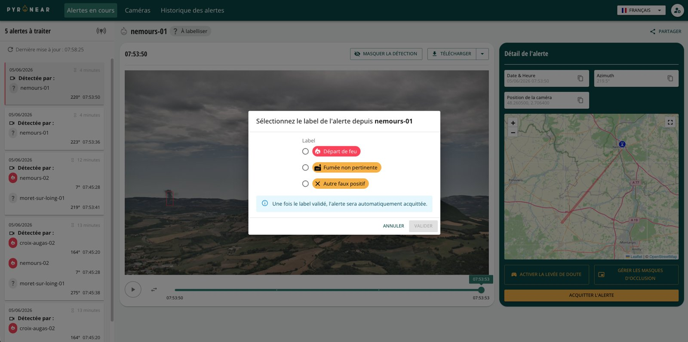
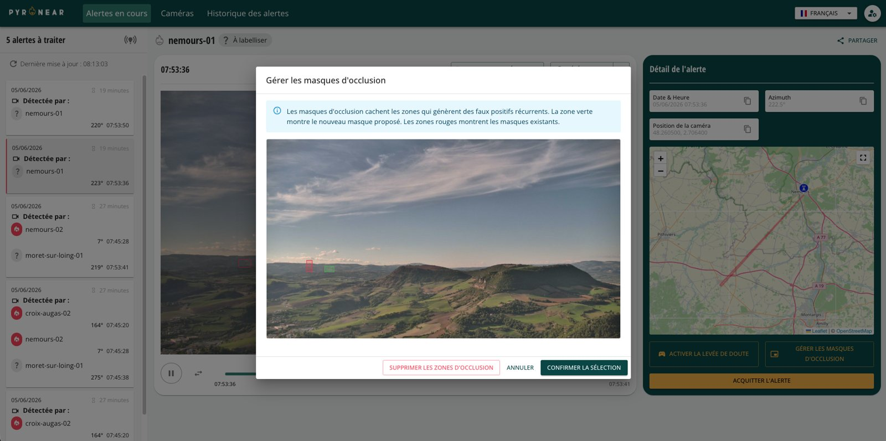
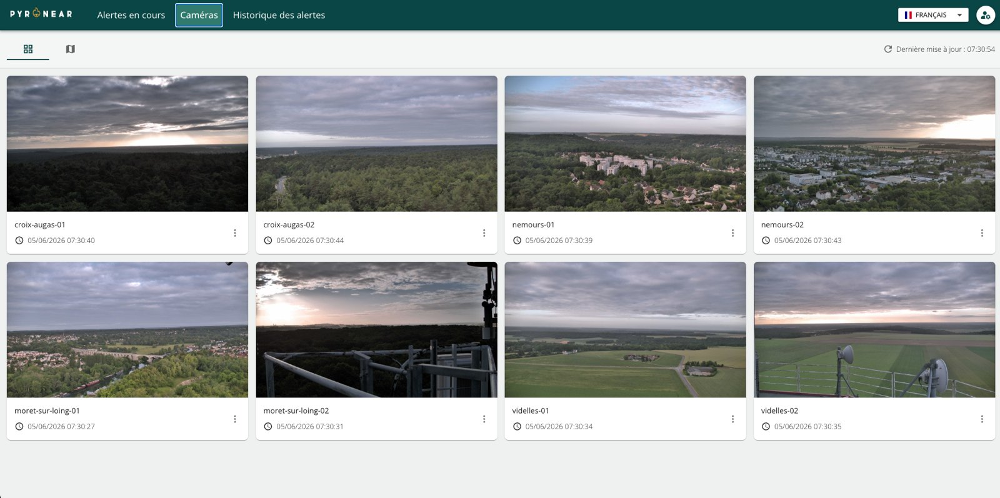

## A complete solution

Pyronear is a **complete fire risk management solution**. It consists of an **early wildfire detection algorithm**, implemented on a microcomputer, connected to **cameras positioned on high spots** with a view on the forest. Our detectors communicate **fire alerts** to a database that is connected to a **supervision platform** for the fire department.



*A mini-documentary about Pyronear, made by Fast Forward.*

## The detection station

Our stations are installed on high points (pylons, water towers, lookout towers) overlooking the forest. High-resolution cameras cover the horizon at 360°, and a credit-card-sized micro-computer analyses the images on site with our artificial intelligence model. Very energy-efficient, a station can run on a solar panel and communicates over 4G.

- Smoke detection up to **15 km** away
- Up to **2 hours earlier** than the first emergency calls
- On-site analysis, **very low power use**, standard hardware
- Record: a fire start detected **42 km** away

A station is installed in less than half a day: [see how]().

Our detection towers consist of 4/5 high resolution cameras and a micro computer. We capture one image per camera at regular intervals and then analyze it locally using our wildfire detection model. In case of detection, the alert mode is activated, all the images coming from the camera having detected the fire are then sent to our database via our api, the communication protocol we have developed.





## Fewer false alarms

Early smoke can look like a cloud, fog or dust. To avoid alerting firefighters for nothing, every detection goes through two steps:

1. **Spot**: on each image, our model flags anything that looks like smoke.
2. **Confirm**: the system follows this smoke over several images. Real smoke stays in the same place, grows and slowly drifts, unlike a cloud.

The result: **4 times fewer false alarms**, without missing real fires.

## The alert platform

When a station detects smoke, the images are sent to our web platform. Fire service operators receive the alert in real time: they confirm it, control the cameras and locate the fire by triangulation between several stations.

In April 2026, a station spotted the first fire of the year in the Fontainebleau forest, twenty minutes before the first emergency call.

What the platform does:

- **Live alerts**: today's alerts, with image sequences you can play and zoom into.
- **Fire location**: when several cameras see the same smoke, its position appears on the map.
- **Remote check**: take control of a camera remotely (direction, zoom, click to center) to confirm or rule out an alert.
- **Labelling**: classify each alert as a fire start, irrelevant smoke or another false positive.
- **Masks**: ignore recurring smoke, such as a factory chimney.
- **Camera monitoring**: the status and latest image of each camera, with a warning if one goes offline.
- **Sharing and history**: send an alert to a colleague, find past alerts and export them as CSV.





## Try the model

Test our detection model in your browser: pick a camera image and watch it spot the smoke.



## An open approach

Code, models, data and hardware: everything we build is open. [Discover our open approach]().
