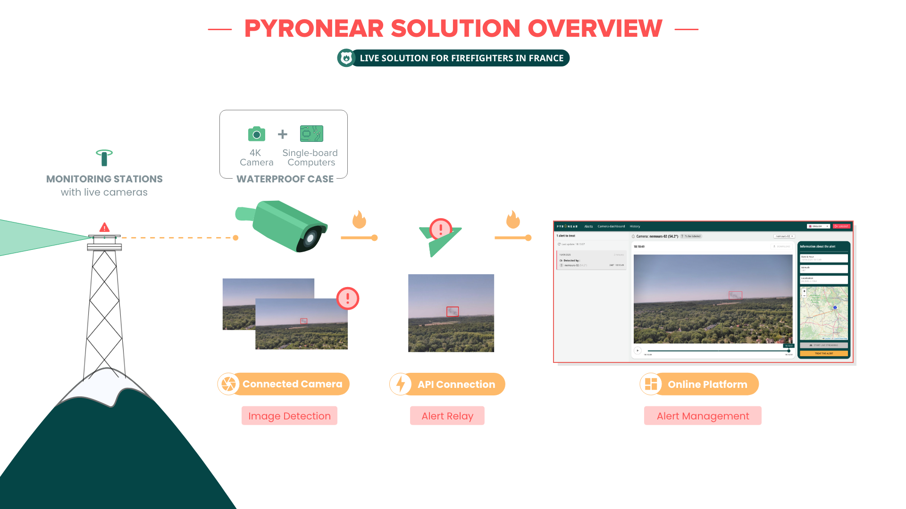
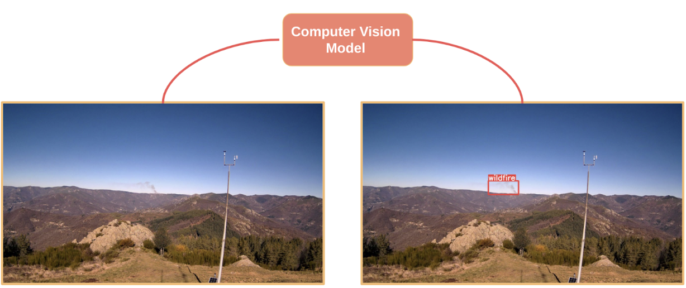
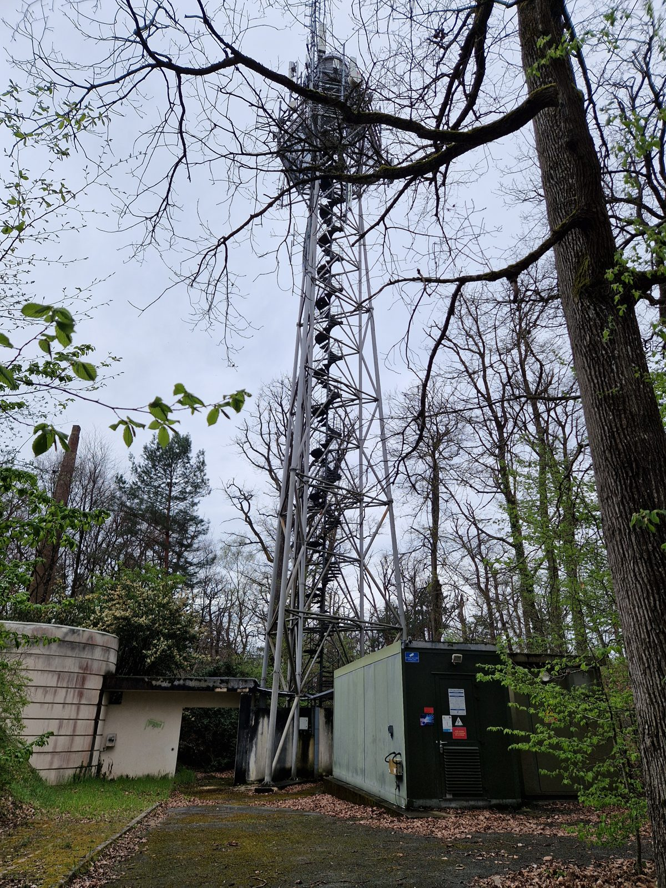
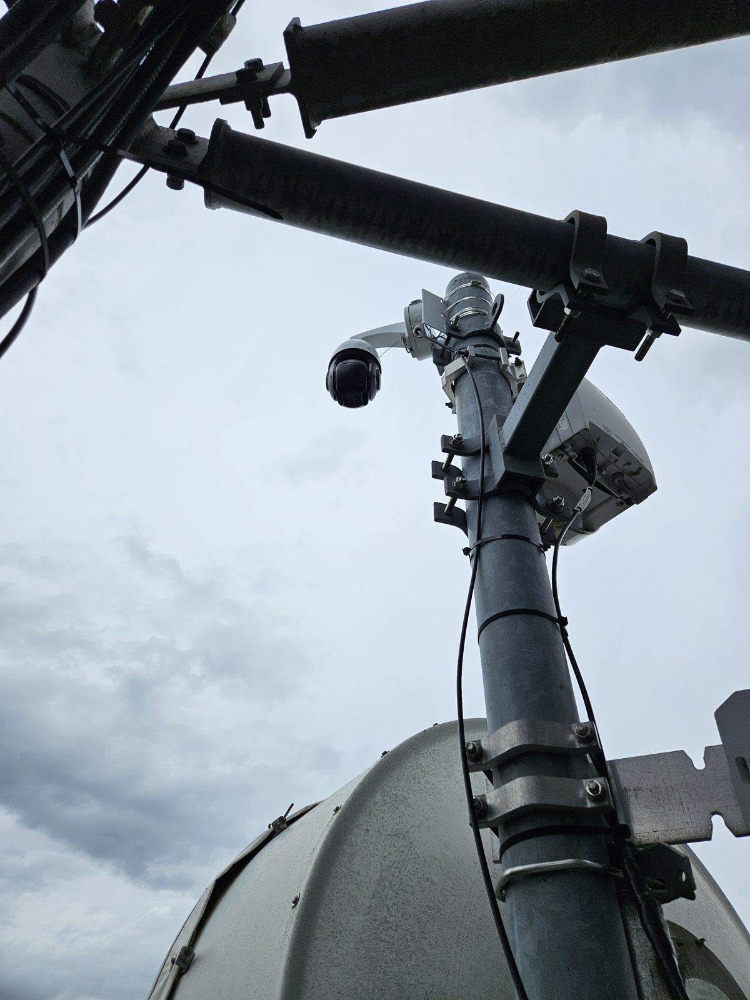
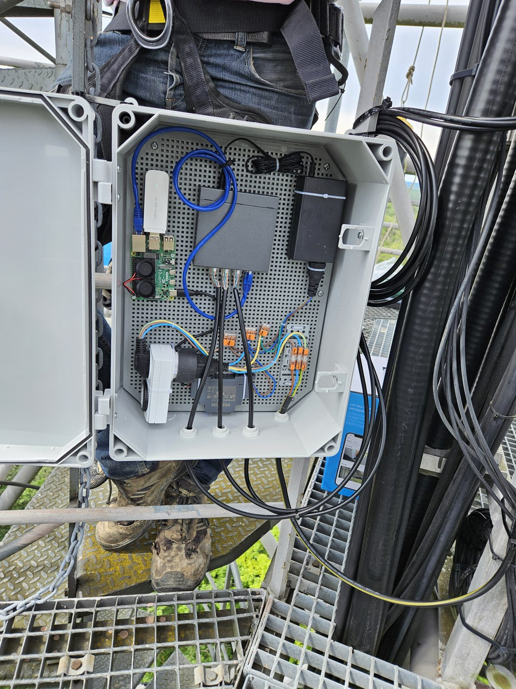
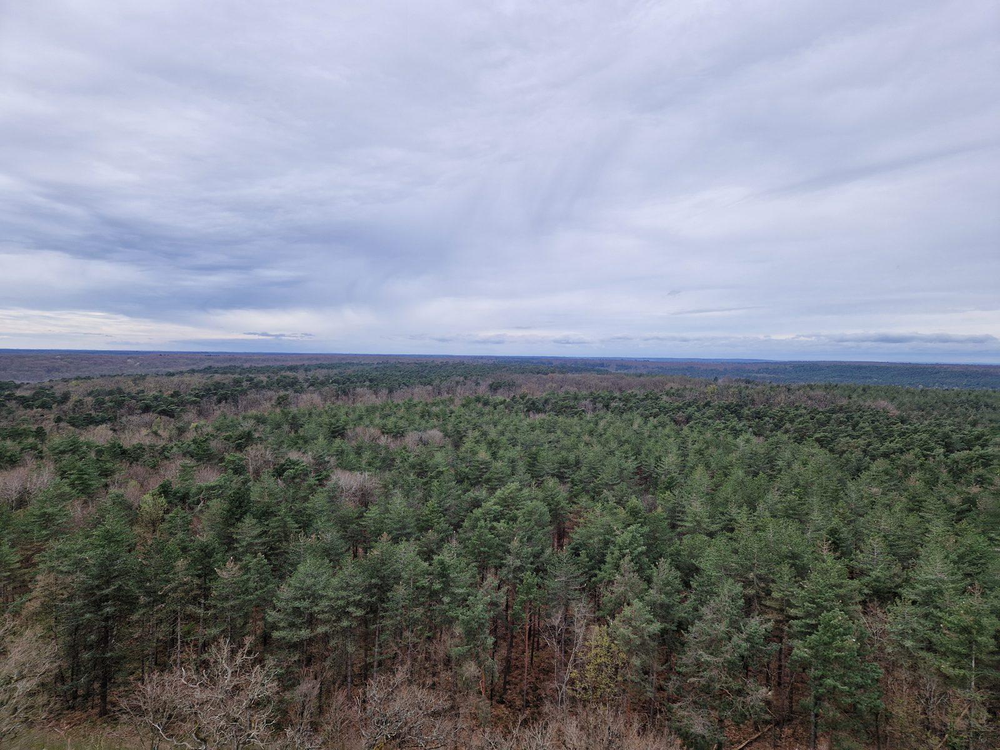
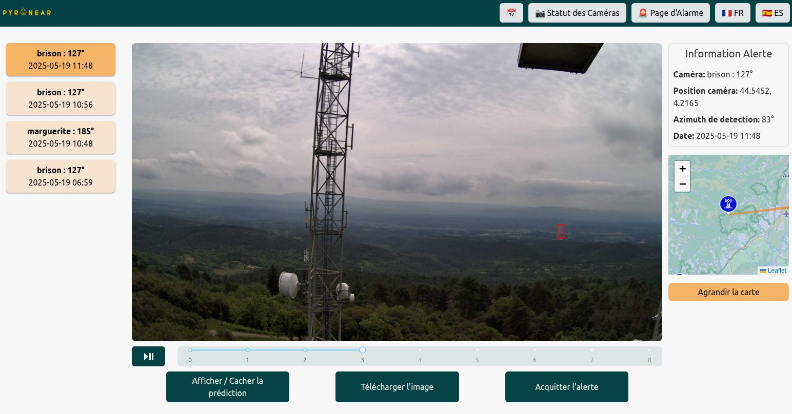

## A complete solution

Pyronear is a **complete fire risk management solution**: **cameras** installed on high points, our own stations or cameras already in place, **detect fire starts early** thanks to a lightweight, embedded AI. Fire services **quickly receive** an alert, which they **analyse and assess** on our supervision platform.



*A mini-documentary about Pyronear, made by Fast Forward.*

## The detection station

Our stations are installed on high points (pylons, water towers, lookout towers) overlooking natural areas. They usually have 2 PTZ detection cameras, covering the horizon at 360°, and a credit-card-sized micro-computer. It captures an image per camera at regular intervals and analyses it on site with our artificial intelligence model. Very energy-efficient, a station can run on a solar panel and communicates over 4G.

- Detection up to **25 km**. *A record at 72 km.*
- Up to **2 hours earlier** than the first emergency calls
- On-site analysis, **very low power use**, standard hardware
- Works with **cameras already in place**: our detection can also connect to existing camera networks

A station is installed in less than half a day: [see how]().





## Alert and analyse

When a camera detects smoke, the station switches to alert mode: all the images from the camera concerned are sent to our database through our API. The alert is sent to users through several channels, depending on their needs, so that it arrives as quickly as possible and they can assess it as well as possible. On our platform, operators confirm it, control the cameras remotely and locate the fire by triangulation between several cameras.

*For example, in April 2026, a station spotted the first fire of the year in the Fontainebleau forest, twenty minutes before the first emergency call.*

## Try the model

Test our detection model in your browser: pick a camera image and watch it spot the smoke.



## Open source

All our work is released under a free licence (Apache 2.0): the station software, the AI models and the platform. Any fire service, local authority or researcher can reuse it without depending on a vendor. Find our code on [GitHub](https://github.com/pyronear).

## Why an open data set?

Our detection algorithm is an **artificial intelligence (AI)** model that has been trained on numerous **images of fire outbreaks**. In other words, the algorithm has been trained to recognise smoke and flames in numerous situations and in different areas.

To this end, **with the help of our partners and volunteers**, we are building a **dataset** that we are sharing in **open data**, so that the images collected and annotated can be used by as many people as possible. In this way, by sharing these resources, we are increasing the chances of preserving another resource: forests and natural areas.

- [Find the dataset on HuggingFace](https://huggingface.co/datasets/pyronear/pyro-sdis)
- [Legal note for fire services who want to share their images (in French)](https://pyronear.notion.site/Notes-de-synth-se-FAQ-du-webinaire-open-data-DINUM-SDIS-MSP-18c425b63668806cb5dbc7a35d7452b4)

## Going further

Our partner [EarthToolsMaker](https://www.earthtoolsmaker.org/) explains in detail how we improved our models:

- [Smoke Is a Behavior: Inside Pyronear's Temporal Wildfire Detection Model](https://www.earthtoolsmaker.org/posts/smoke-is-a-behavior/)
- [Racing Models, Not Opinions: How We Ran Wildfire ML R&D for Pyronear](https://www.earthtoolsmaker.org/posts/racing-models-not-opinions/)
- [Protecting the Forest: Building an early forest fire detector](https://www.earthtoolsmaker.org/posts/protecting-the-forest-early-forest-fire-detector/)
