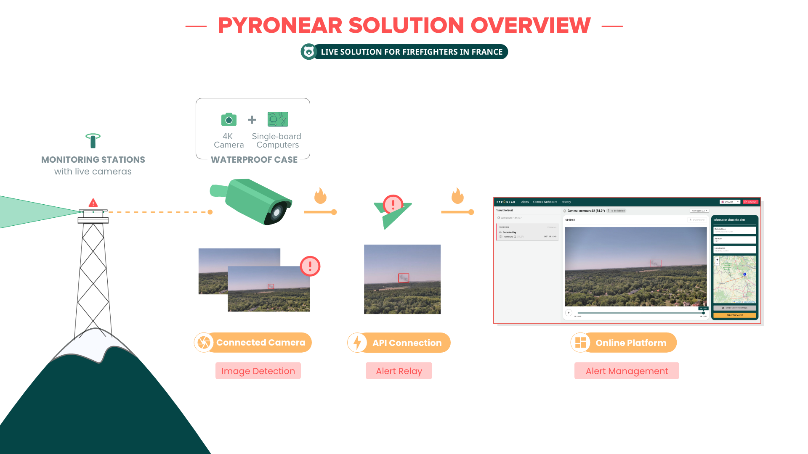
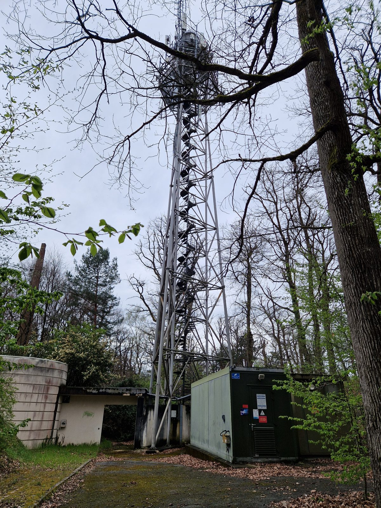
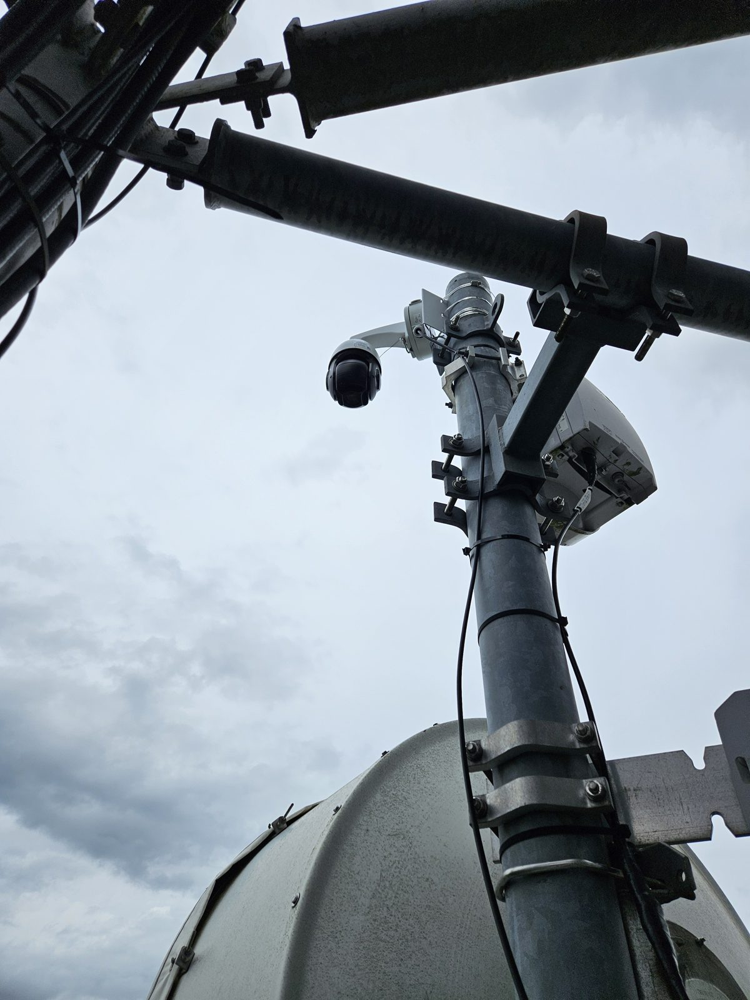
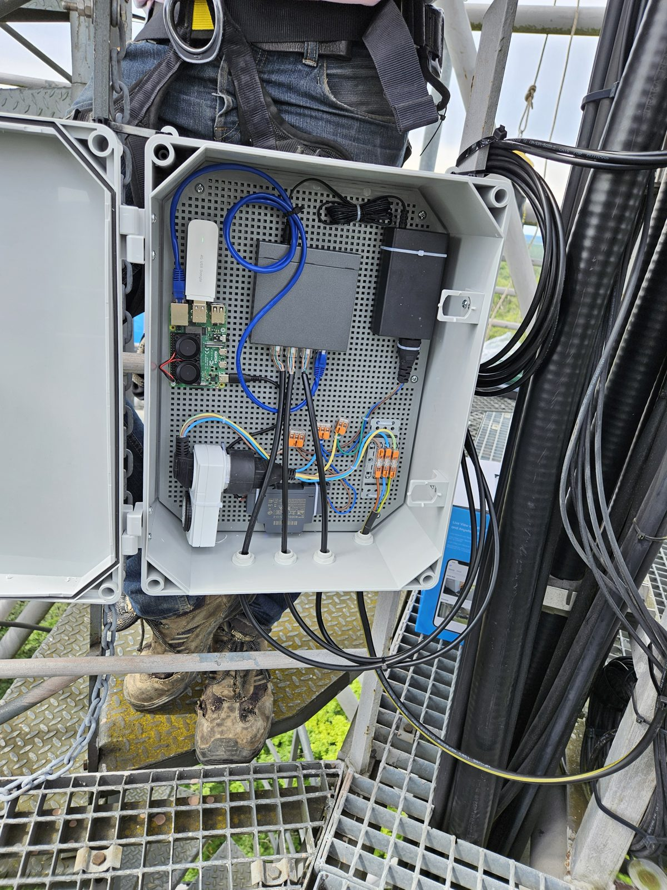
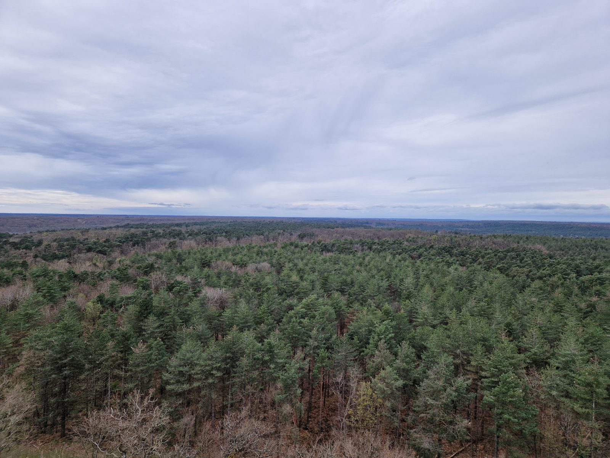
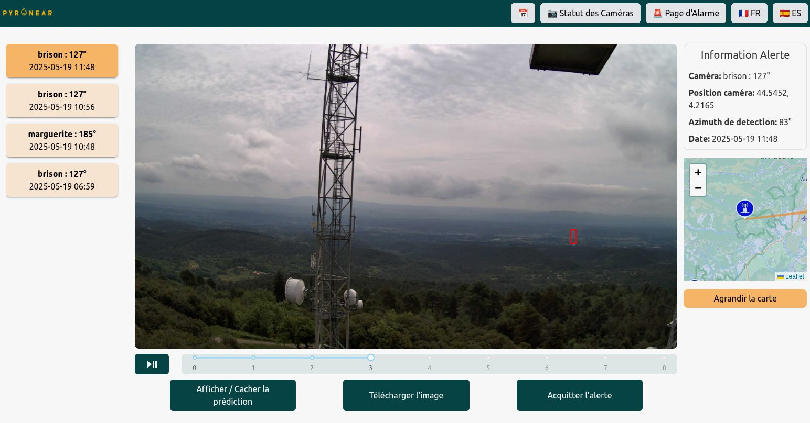

## Una solució completa

Pyronear és una **solució completa de gestió del risc d'incendi**: **càmeres** instal·lades en punts alts, les nostres pròpies estacions o càmeres ja instal·lades, **detecten de manera precoç** els inicis d'incendi gràcies a una IA lleugera i integrada. Els serveis de bombers **reben ràpidament** una alerta, que **analitzen i qualifiquen** a la nostra plataforma de supervisió.



*Un minidocumental sobre Pyronear, realitzat per Fast Forward.*

## L'estació de detecció

Les nostres estacions s'instal·len en punts alts (torres elèctriques, dipòsits d'aigua, torres de guaita) amb vista als espais naturals. Solen tenir 2 càmeres PTZ de detecció, que cobreixen l'horitzó a 360°, i un microordinador de la mida d'una targeta de crèdit. Captura regularment una imatge per càmera i l'analitza in situ amb el nostre model d'intel·ligència artificial. Molt sòbria en energia, l'estació pot funcionar amb un panell solar i es comunica per 4G.

- Detecció fiable fins a **20 km**. *Un rècord a 72 km.*
- Fins a **2 hores d'avançament** sobre les primeres trucades d'emergència
- Anàlisi in situ, **consum molt baix**, maquinari estàndard
- Compatible amb **càmeres ja instal·lades**: la nostra detecció també es pot connectar a xarxes de càmeres existents

Una estació s'instal·la en menys de mitja jornada: [vegeu com]().





## Alertar i analitzar

Quan una càmera detecta fum, l'estació passa a mode d'alerta: totes les imatges de la càmera afectada s'envien a la nostra base de dades a través de la nostra API. L'alerta es notifica als usuaris per diversos canals, segons les seves necessitats, perquè arribi com més aviat millor i la puguin qualificar el millor possible. A la nostra plataforma, els operadors la confirmen, controlen les càmeres a distància i localitzen l'incendi per triangulació entre diverses càmeres.

*Per exemple, l'abril del 2026, una estació va detectar el primer incendi de l'any al bosc de Fontainebleau, vint minuts abans de la primera trucada d'emergència.*

## Prova el model

Prova el nostre model de detecció al navegador: dona-li un vídeo o una seqüència d'imatges de càmera, o si no una sola imatge, i mira com detecta el fum.





## Un enfocament obert

Codi, models, dades i maquinari: tot el que construïm és obert. [Descobreix el nostre enfocament obert]().
