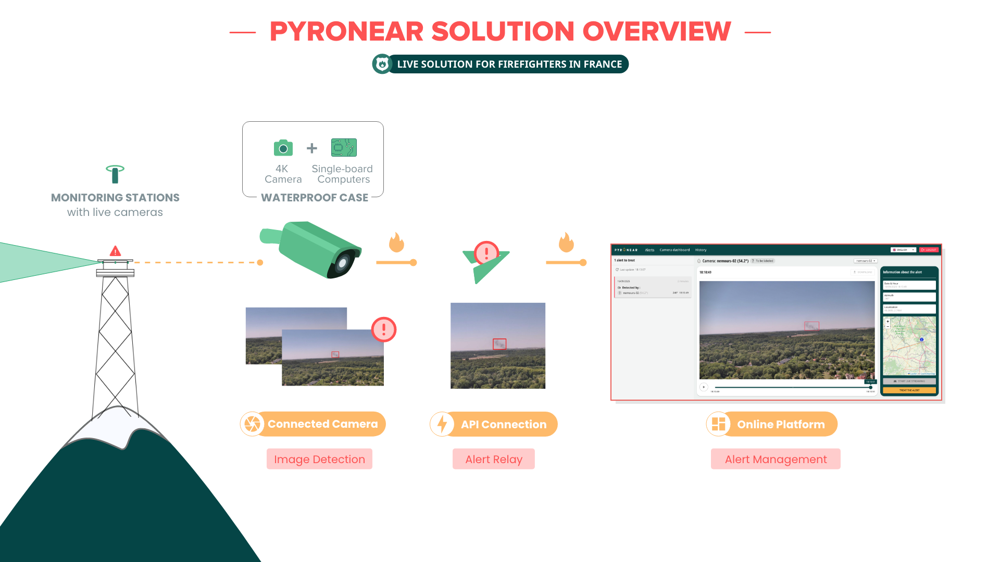
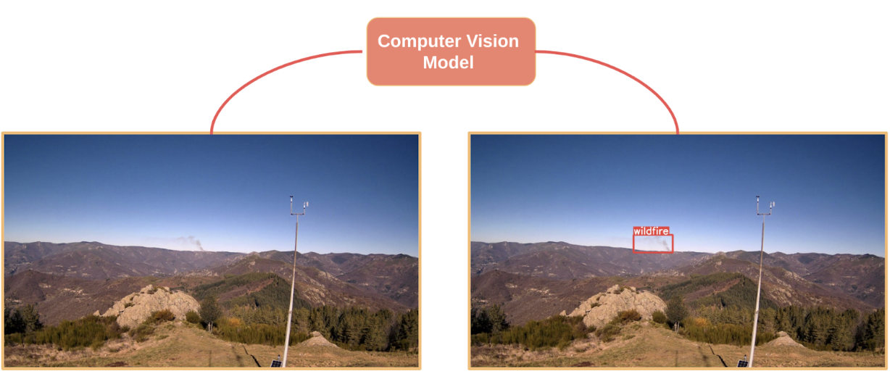
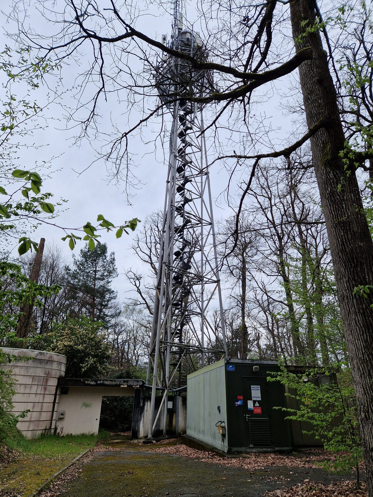
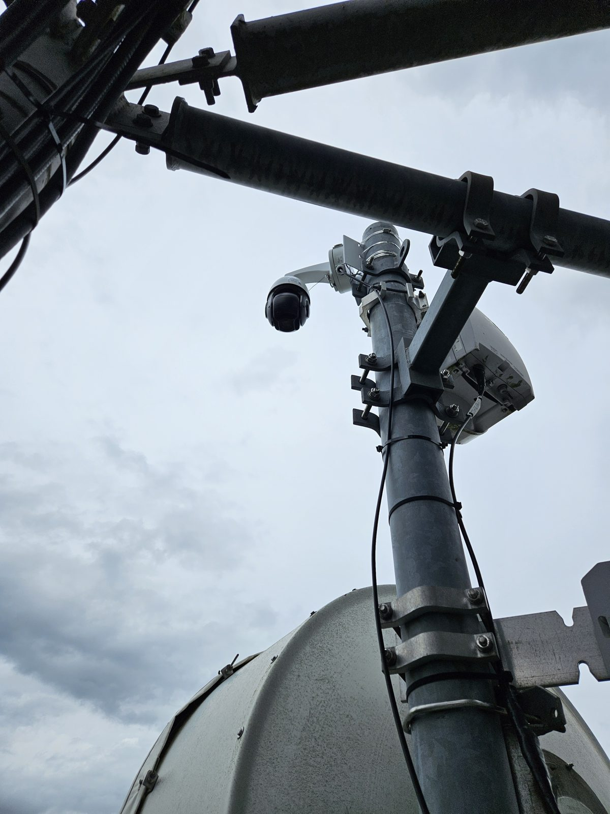
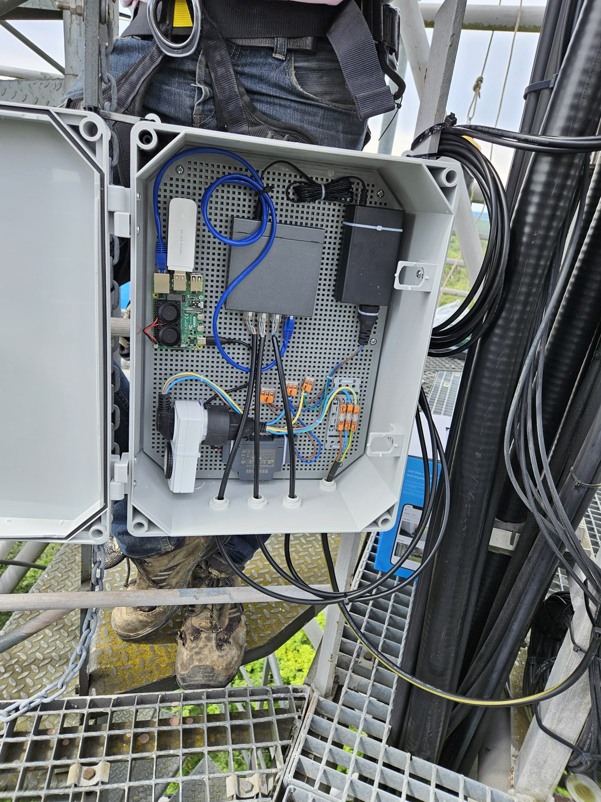
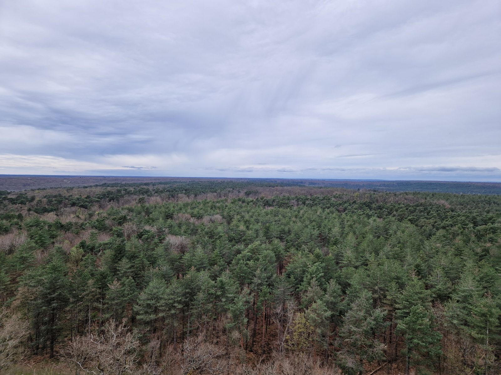
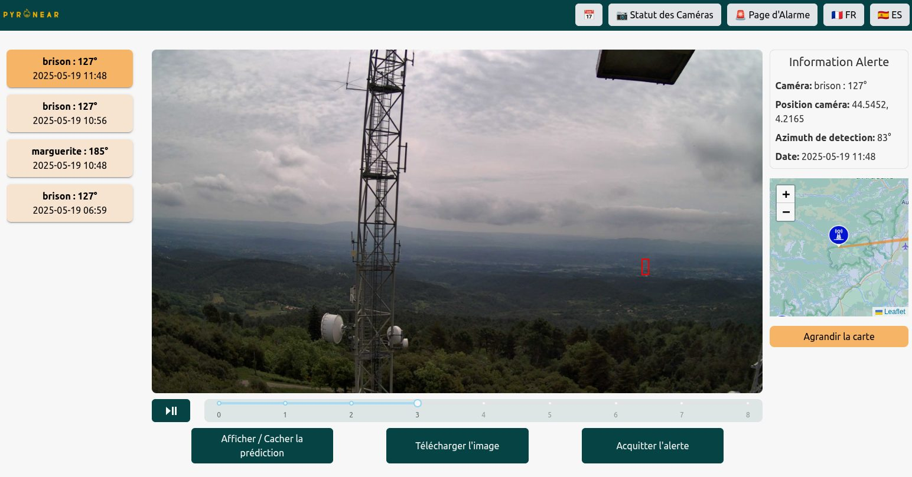

## Una solución completa

Pyronear es una **solución completa de gestión del riesgo de incendio**: **cámaras** instaladas en puntos altos, nuestras propias estaciones o cámaras ya instaladas, **detectan de forma temprana** los inicios de incendio gracias a una IA ligera e integrada. Los servicios de bomberos **reciben rápidamente** una alerta, que **analizan y evalúan** en nuestra plataforma de supervisión.



*Un minidocumental sobre Pyronear, realizado por Fast Forward.*

## La estación de detección

Nuestras estaciones se instalan en puntos altos (torres eléctricas, depósitos de agua, torres de vigilancia) con vistas a los espacios naturales. Suelen tener 2 cámaras PTZ de detección, que cubren el horizonte a 360°, y un microordenador del tamaño de una tarjeta de crédito. Captura regularmente una imagen por cámara y la analiza in situ con nuestro modelo de inteligencia artificial. Muy sobria en energía, la estación puede funcionar con un panel solar y se comunica por 4G.

- Detección fiable hasta **20 km**. *Un récord a 72 km.*
- Hasta **2 horas de adelanto** sobre las primeras llamadas de emergencia
- Análisis in situ, **consumo muy bajo**, hardware estándar
- Compatible con **cámaras ya instaladas**: nuestra detección también puede conectarse a redes de cámaras existentes

Una estación se instala en menos de media jornada: [ver cómo]().





## Alertar y analizar

Cuando una cámara detecta humo, la estación pasa a modo de alerta: todas las imágenes de la cámara afectada se envían a nuestra base de datos a través de nuestra API. La alerta se notifica a los usuarios por varios canales, según sus necesidades, para que llegue lo antes posible y puedan evaluarla lo mejor posible. En nuestra plataforma, los operadores la confirman, controlan las cámaras a distancia y localizan el incendio por triangulación entre varias cámaras.

*Por ejemplo, en abril de 2026, una estación detectó el primer incendio del año en el bosque de Fontainebleau, veinte minutos antes de la primera llamada de emergencia.*

## Prueba el modelo

Prueba nuestro modelo de detección en tu navegador: elige una imagen de cámara y mira cómo detecta el humo.



## Un enfoque abierto

Código, modelos, datos y hardware: todo lo que construimos es abierto. [Descubre nuestro enfoque abierto]().
