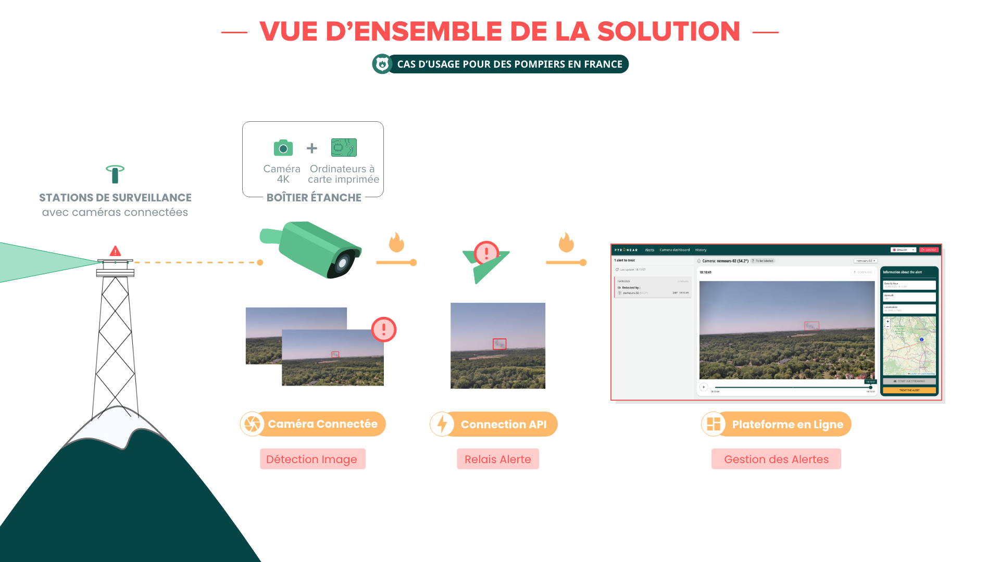
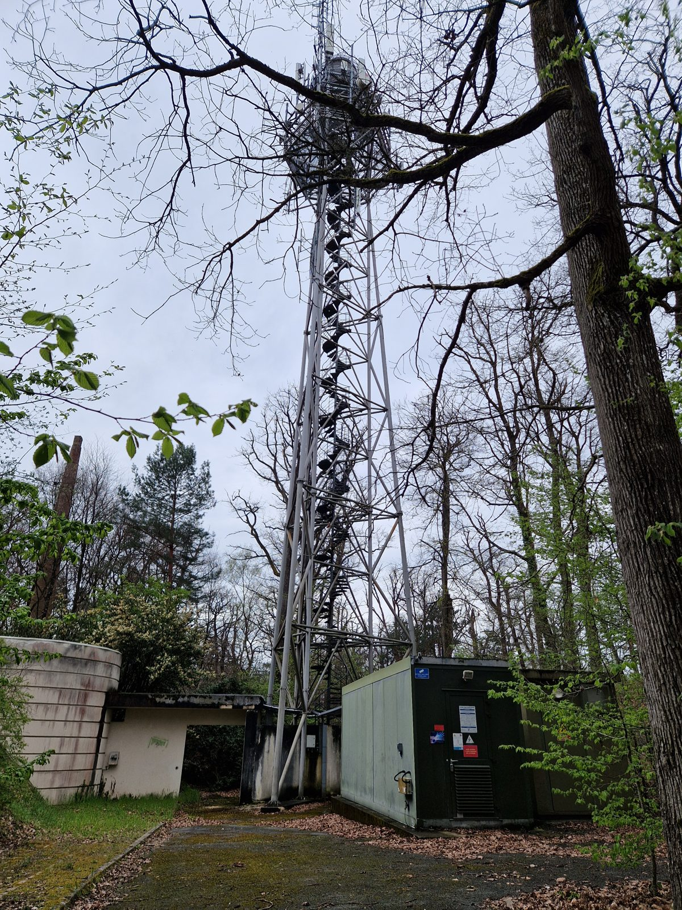
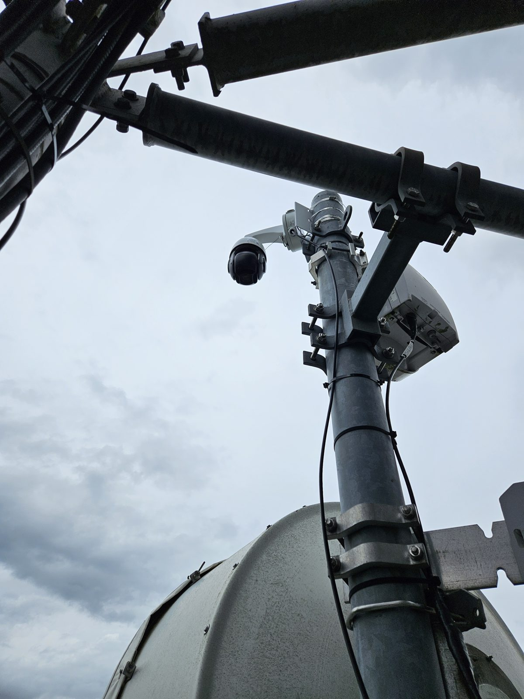
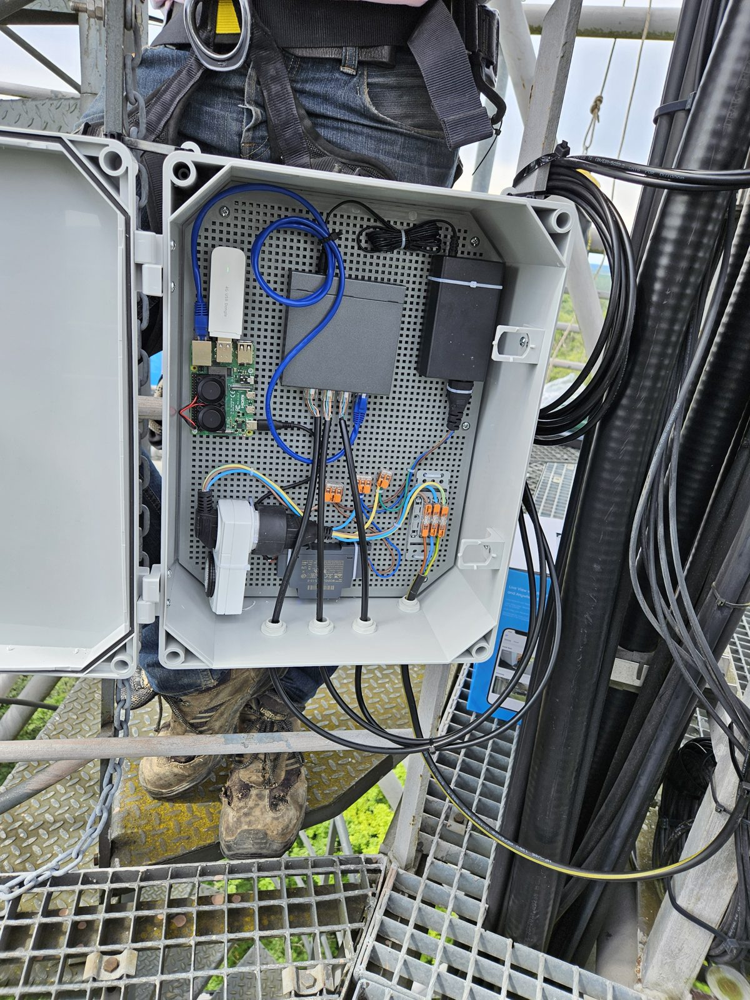
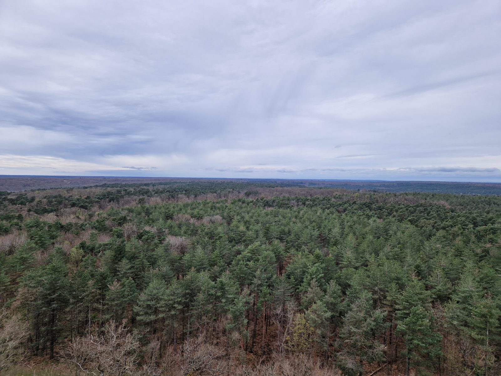
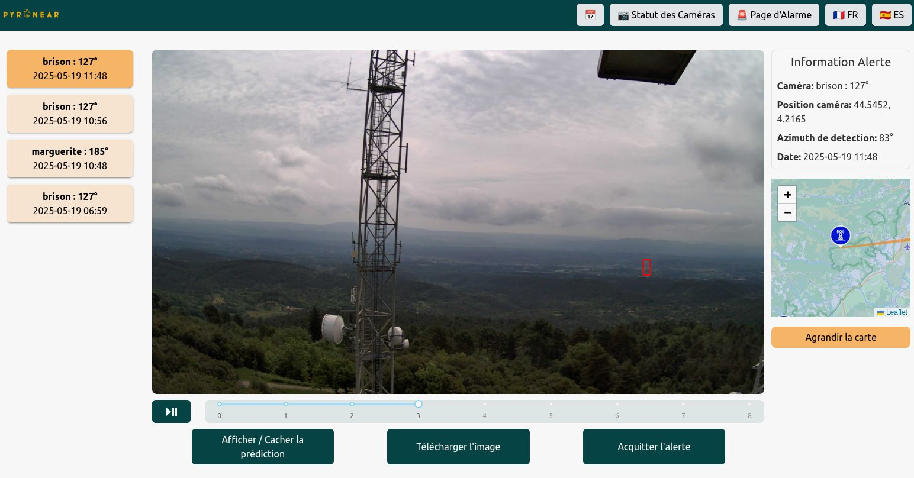

## Une solution complète

Pyronear est une **solution complète de gestion du risque incendie** : des **caméras** installées sur des points hauts, nos propres stations ou des caméras déjà en place, **détectent précocement** les départs de feu grâce à une IA légère et embarquée. Les services d'incendie **reçoivent rapidement** une alerte, qu'ils **analysent et qualifient** sur notre plateforme de supervision.



*Mini-documentaire sur Pyronear, réalisé par Fast Forward.*

## La station de détection

Nos stations sont installées sur des points hauts (pylônes, châteaux d'eau, tours de guet) avec vue sur les espaces naturels. Elles comptent généralement 2 caméras PTZ de détection, qui couvrent l'horizon à 360°, et un micro-ordinateur de la taille d'une carte de crédit. Il capture régulièrement une image par caméra et l'analyse sur place avec notre modèle d'intelligence artificielle. Très sobre en énergie, la station peut fonctionner sur panneau solaire et communique en 4G.

- Détection fiable jusqu'à **20 km**. *Un record à 72 km.*
- Jusqu'à **2 heures d'avance** sur les premiers appels au 18
- Analyse sur place, **très faible consommation**, matériel standard
- Compatible avec des **caméras déjà en place** : notre détection peut aussi se connecter à des réseaux de caméras existants

Une station s'installe en moins d'une demi-journée : [voir comment]().





## Alerter et analyser

Quand une caméra détecte une fumée, la station passe en mode alerte : toutes les images de la caméra concernée sont envoyées à notre base de données via notre API. L'alerte est notifiée aux utilisateurs par plusieurs canaux, selon leurs besoins, pour qu'elle arrive au plus vite et qu'ils puissent la qualifier au mieux. Sur notre plateforme, les opérateurs lèvent le doute, pilotent les caméras à distance et localisent le départ de feu par triangulation entre plusieurs caméras.

*Par exemple, en avril 2026, une station a repéré le premier feu de l'année en forêt de Fontainebleau, vingt minutes avant le premier appel au 18.*

## Essayer le modèle

Testez notre modèle de détection dans votre navigateur : donnez-lui une vidéo ou une séquence d'images de caméra, ou à défaut une simple image, et regardez-le repérer les fumées.





## Une démarche ouverte

Code, modèles, données et matériel : tout ce que nous construisons est ouvert. [Retrouvez notre démarche ouverte]().
