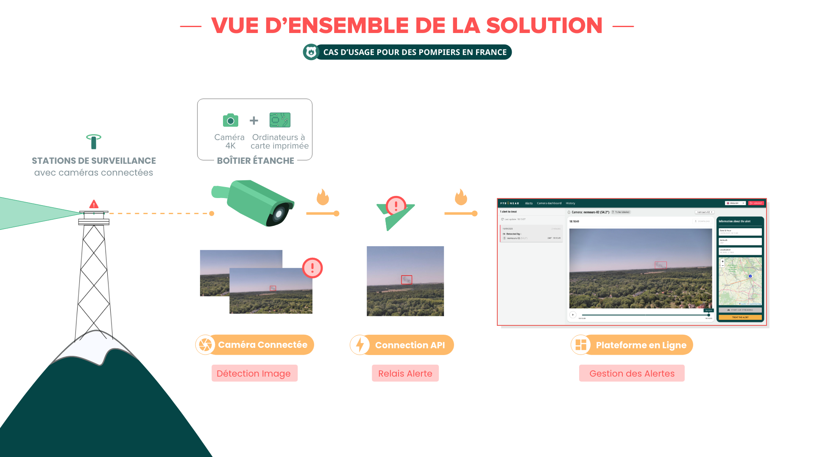

## Une solution complète

Pyronear est une **solution complète de gestion du risque incendie** : des **caméras** installées sur des points hauts, nos propres stations ou des caméras déjà en place, **détectent précocement** les départs de feu grâce à une IA légère et embarquée. Les services d'incendie **reçoivent rapidement** une alerte, qu'ils **analysent et qualifient** sur notre plateforme de supervision.



*Mini-documentaire sur Pyronear, réalisé par Fast Forward.*

## La station de détection

Nos stations sont installées sur des points hauts (pylônes, châteaux d'eau, tours de guet) avec vue sur les espaces naturels. Elles comptent généralement 2 caméras PTZ de détection, qui couvrent l'horizon à 360°, et un micro-ordinateur de la taille d'une carte de crédit. Il capture régulièrement une image par caméra et l'analyse sur place avec notre modèle d'intelligence artificielle. Très sobre en énergie, la station peut fonctionner sur panneau solaire et communique en 4G.

- Détection jusqu'à **25 km**. *Un record à 72 km.*
- Jusqu'à **2 heures d'avance** sur les premiers appels au 18
- Analyse sur place, **très faible consommation**, matériel standard
- Compatible avec des **caméras déjà en place** : notre détection peut aussi se connecter à des réseaux de caméras existants

Une station s'installe en moins d'une demi-journée : [voir comment]().





## Alerter et analyser

Quand une caméra détecte une fumée, la station passe en mode alerte : toutes les images de la caméra concernée sont envoyées à notre base de données via notre API. L'alerte est notifiée aux utilisateurs par plusieurs canaux, selon leurs besoins, pour qu'elle arrive au plus vite et qu'ils puissent la qualifier au mieux. Sur notre plateforme, les opérateurs lèvent le doute, pilotent les caméras à distance et localisent le départ de feu par triangulation entre plusieurs caméras.

*Par exemple, en avril 2026, une station a repéré le premier feu de l'année en forêt de Fontainebleau, vingt minutes avant le premier appel au 18.*

## Essayer le modèle

Testez notre modèle de détection dans votre navigateur : choisissez une image de caméra et regardez-le repérer les fumées.



## Open source

Tout notre travail est publié sous licence libre (Apache 2.0) : le logiciel des stations, les modèles d'IA et la plateforme. Tout service d'incendie, collectivité ou chercheur peut le réutiliser, sans dépendre d'un fournisseur. Retrouvez notre code sur [GitHub](https://github.com/pyronear).

## Pourquoi un dataset open data ?

Notre algorithme de détection est un **modèle d’intelligence artificielle (IA)** entrainé sur de nombreuses **images de départ de feux**. C’est à dire que l’algorithme a été entrainé à reconnaître des fumées et flammes dans de nombreuses situations et sur différents territoires.

A cette fin, nous construisons **à l’aide de nos partenaires et bénévoles**, un **dataset** que nous partageons en **open data**, afin que les images collectées et annotées puissent servir au plus grande nombre. Ainsi, en mettant en commun ces ressources, nous augmentons les chances de préserver une autre ressource, les forêts et espaces naturels.

- [Retrouvez le dataset sur HuggingFace](https://huggingface.co/datasets/pyronear/pyro-sdis)
- [Note juridique pour les SDIS qui souhaitent partager leurs images](https://pyronear.notion.site/Notes-de-synth-se-FAQ-du-webinaire-open-data-DINUM-SDIS-MSP-18c425b63668806cb5dbc7a35d7452b4)

## Pour aller plus loin

Notre partenaire [EarthToolsMaker](https://www.earthtoolsmaker.org/) raconte en détail comment nous avons amélioré nos modèles (en anglais) :

- [Smoke Is a Behavior: Inside Pyronear's Temporal Wildfire Detection Model](https://www.earthtoolsmaker.org/posts/smoke-is-a-behavior/)
- [Racing Models, Not Opinions: How We Ran Wildfire ML R&D for Pyronear](https://www.earthtoolsmaker.org/posts/racing-models-not-opinions/)
- [Protecting the Forest: Building an early forest fire detector](https://www.earthtoolsmaker.org/posts/protecting-the-forest-early-forest-fire-detector/)
